# RonanSAT — SAT Practice Platform (OOP Lab Demo)

**Presenter:** Le Vinh — 202417221 | Group 08  
**Course:** Object-Oriented Programming Lab | School of Information and Communication Technology (SoICT) — HUST  

A modern full-stack SAT practice platform designed and structured under Object-Oriented Programming (OOP) and Layered Architecture principles. This project serves as an MVP demonstration featuring simulated digital SAT testing, automated scoring, performance analytics, leaderboards, an admin dashboard, and an AI-powered tutor.

---

## 1. Project Overview

RonanSAT simulates the digital SAT testing experience, allowing students to take timed adaptive-style tests across Reading & Writing and Math modules, utilize interactive tools such as the Desmos graphing calculator, submit answers for immediate grading, review incorrect answers with in-depth explanations, and ask an AI Tutor for conceptual guidance.

Administrators can author new practice tests, append questions with passages and options, and manage the student Hall of Fame.

### Tech Stack
- **Framework:** Next.js 16.1.6 (App Router, Turbopack)
- **Frontend:** React 19.2.3, TypeScript 5, Tailwind CSS 4, Ant Design, Lucide React
- **Typography & Math:** KaTeX 0.16.22 for LaTeX math rendering (`\( \)` inline & `\[ \]` display)
- **Security:** DOMPurify (`isomorphic-dompurify`) strict HTML sanitization allow-list
- **Backend:** Next.js Route Handlers (RESTful architecture)
- **Database:** MongoDB via Mongoose 9.2.2 (with `mongodb-memory-server` for zero-config demonstration)
- **Authentication:** NextAuth.js 4 (JWT session strategy, bcryptjs password hashing)
- **Validation:** Zod 4 runtime schema validation
- **AI Tutoring:** Google Generative AI (Gemini 2.5 Flash) with offline fallback

---

## 2. Real Production Sample Data & Importer

### A. Production Sample Data Source
The demo is seeded with real SAT practice exams exported from the production PostgreSQL platform (`data/prod-sample-tests.json`):
1. **2025 March INT - A:** 84 multiple-choice questions across 4 modules (Reading & Writing M1: 27, Reading & Writing M2: 27, Math M1: 15, Math M2: 15).
2. **2025 October US - A:** 87 multiple-choice questions across 4 modules (Reading & Writing M1: 27, Reading & Writing M2: 27, Math M1: 16, Math M2: 17).

> **Note on Free-Response (`spr`):** In this app version, Student-Produced Response (`spr`) questions without multiple-choice options are skipped by the importer, and each section's `questionsCount` is dynamically recomputed from the actual questions imported.

### B. OOP Importer Architecture (`lib/seed/prodSampleImporter.ts`)
The `ProdSampleImporter` class encapsulates the translation logic from external database schemas onto existing Mongoose domain models:
- **`ProdSampleImporter` Class:**
  - `loadRawData()`: Reads and parses `data/prod-sample-tests.json`.
  - `mapSectionName(name)`: Normalizes `"Verbal"` to `"Reading and Writing"` while preserving `"Math"`.
  - `resolveImageUrl(imageUrl)`: Downloads and caches images offline to `public/demo-figures/` via `scripts/fetch-demo-figures.ts`, serving them locally as `/demo-figures/<hash>.png` without internet reliance.
  - `formatChoicesAndAnswer(rawQ)`: Sorts options by `display_order` into `choices: string[]`, maps `question_correct_options.option_id` onto the matching option text for `correctAnswer`.
  - `mapQuestion(rawQ, testId, sectionName, moduleNumber)`: Maps raw question fields, handling LaTeX formatting, passages, difficulty, points, and local images.
  - `importTest(rawTest)`: Sorts sections by `display_order`, sorts questions by `position`, recomputes section counts, and saves `Test` and `Question` records atomically.
  - `importAll()`: Orchestrates batch import of all production sample tests.

### C. RichText LaTeX & HTML Display (`components/RichText.tsx`)
All user-facing question text, reading passages, multiple-choice options, and review explanations are rendered through a single unified `RichText` component:
- **KaTeX Integration:** Parses inline delimiters `\( ... \)` and block display delimiters `\[ ... \]`, as well as escaped dollar signs (`\$`) into mathematical formulas.
- **HTML Sanitization:** Employs `isomorphic-dompurify` configured with an explicit allow-list (`<p>`, `<strong>`, `<em>`, `<u>`, `<br>`, `<sup>`, `<sub>`, `<table>`, `<th>`, `<td>`, plus KaTeX MathML/SVG nodes) to strictly eliminate XSS risks while preserving formatting and tables.

---

## 3. Object-Oriented Programming (OOP) Architecture

The application design incorporates key OOP principles across its layers:

### A. Encapsulation
- **Service Layer Encapsulation:** Business logic is encapsulated inside dedicated domain services (`testService`, `questionService`, `resultService`, `chatService`, `userService`). API routes do not query the database directly; instead, they interact with service methods that manage database connections (`dbConnect()`), transactional integrity, and entity relationships.
- **Controller Encapsulation:** Controllers (`testController`, `questionController`, `resultController`, `chatController`, `userController`) encapsulate HTTP parameter extraction, authorization checks, and standard HTTP response formatting.
- **Validation Encapsulation:** Zod schemas (`TestValidationSchema`, `QuestionValidationSchema`, `ResultValidationSchema`, `UserValidationSchema`) encapsulate all data invariants, boundary constraints, and type coercion.

### B. Abstraction via Interfaces
- **TypeScript Domain Interfaces:** Strong abstraction barriers separate data structures from implementation details:
  - `IUser` (`lib/models/User.ts`)
  - `ITest` & `Section` (`lib/models/Test.ts`)
  - `IQuestion` (`lib/models/Question.ts`)
  - `IResult` & `IAnswer` (`lib/models/Result.ts`)
  - `IChat` & `IMessage` (`lib/models/Chat.ts`)
  - `IStudent` (`lib/models/studentCard.ts`)
- Consumers interact with these interfaces without coupling to internal Mongoose BSON serialization or database-specific mechanisms.

### C. Layered Separation of Concerns
The application follows a strict 4-tier layered architecture:
1. **Presentation Layer (Next.js Pages & Client Components):** UI state, rendering, event handling (`app/`, `components/`).
2. **API Route Layer:** HTTP endpoint handlers (`app/api/*/route.ts`).
3. **Controller Layer:** Request parsing and security verification (`lib/controllers/`).
4. **Service & Domain Layer:** Core business logic, scoring, and analytics (`lib/services/`).
5. **Persistence & Data Access Layer:** Mongoose models and Zod schemas (`lib/models/`, `lib/schema/`).

### D. Inheritance and Composition
- **Interface Inheritance:** Model interfaces extend Mongoose's base `Document` interface (e.g. `interface IQuestion extends Document`), inheriting document life-cycle hooks, `.save()`, `.populate()`, and MongoDB ObjectID generation. (Note: Domain models do not use class inheritance; they leverage TypeScript interface inheritance).
- **Schema Composition (Embedded Documents):**
  - `Test` **composes** multiple `Section` entities (`sections: [SectionSchema]`).
  - `Result` **composes** an array of `IAnswer` entities (`answers: [AnswerSchema]`).
  - `Chat` **composes** an array of `IMessage` entities (`messages: [MessageSchema]`).
- **Entity Aggregation / Association:** `Test` aggregates references to `Question` documents via ObjectIds (`questions: [{ type: Schema.Types.ObjectId, ref: "Question" }]`), allowing questions to be queried independently or populated when needed.

### E. Concrete Class Implementation (`ProdSampleImporter`)
- While domain models use Mongoose schemas and services use structured object literals, the project features a full concrete TypeScript class: **`ProdSampleImporter`** (`lib/seed/prodSampleImporter.ts`).
- **Encapsulation:** Houses `private readonly dataFilePath: string` with constructor initialization.
- **Methods:** Encapsulates the entire translation pipeline (`loadRawData`, `mapSectionName`, `resolveImageUrl`, `formatChoicesAndAnswer`, `mapQuestion`, `importTest`, `importAll`) from raw PostgreSQL export to Mongoose domain models.

### F. Polymorphism — Honest Evaluation & Refactoring Roadmap
- **Current State:** The MVP codebase currently relies on TypeScript interfaces, Mongoose query methods, and structured service/controller objects. It does **not** yet implement runtime class inheritance or polymorphic class hierarchies. Features such as role separation (`role: "user" | "admin"`) and test modes (`isSectional: boolean`) are implemented via union types and conditional logic rather than subclass polymorphism.
- **Planned Polymorphic Roadmap:**
  1. **Service Class Hierarchy:** Refactor object literal services into classes extending an `abstract class BaseService<T extends Document>` with generic CRUD methods (`findById`, `findAll`, `create`).
  2. **Strategy Pattern for Scoring:** Introduce an `IScoringStrategy` interface with polymorphic concrete classes (`FullLengthScoringStrategy` and `SectionalScoringStrategy`) to eliminate conditional score computation.

---

## 4. How to Run (One-Command MVP)

The demo requires **zero external accounts or MongoDB Atlas setup**. It uses `mongodb-memory-server` to spin up an in-memory database on a fixed local port and automatically seeds demo data.

### Step 1: Install Dependencies
```bash
npm install
```

### Step 2: Download Demo Figures (Offline Caching)
```bash
npx tsx scripts/fetch-demo-figures.ts
```

### Step 3: Launch the Demo
```bash
npm run demo
```

This single command will:
1. Start an in-memory MongoDB instance on fixed port `27018`.
2. Seed both production SAT practice tests (`2025 March INT - A` and `2025 October US - A`), past student results (Scores: 1520 & 1540), sectional practices, leaderboard entries, and student cards.
3. Automatically configure `MONGODB_URI`, `NEXTAUTH_URL=http://localhost:3000`, and `NEXTAUTH_SECRET`.
4. Launch the Next.js development server on `http://localhost:3000`.
5. Shut down all child processes and the in-memory database cleanly upon `Ctrl+C`.

> **Note on Real MongoDB:** If you prefer connecting to a real MongoDB instance, specify `MONGODB_URI` in `.env.local`. The demo script will detect it and connect to your external database instead of the in-memory server.

---

## 5. Demo Accounts

| Role | Email | Password | Access Rights |
| :--- | :--- | :--- | :--- |
| **Admin** | `admin@ronansat.com` | `AdminPassword123!` | Full admin dashboard (`/admin`), test authoring, question creation, Hall of Fame management. |
| **Student** | `student@ronansat.com` | `StudentPassword123!` | Practice tests, Desmos calculator, submission, result review, leaderboard, AI tutor. |

---

## 6. Screenshots of Application Features

The following screenshots are verified and stored under [`docs/screenshots/`](docs/screenshots/):

### 1. Reading and Writing Question with Passage
*Shows formatted passage on the left panel with underlined text, and question prompt with multiple-choice bubbles on the right panel.*
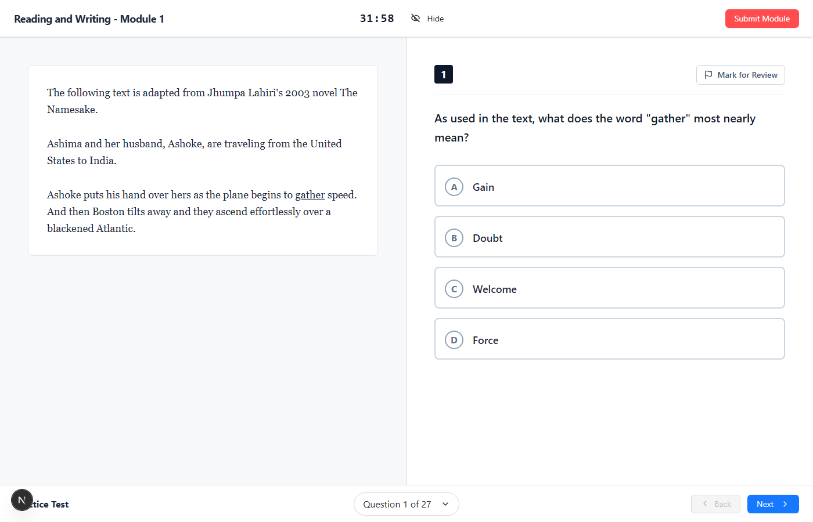

---

### 2. Math Question with KaTeX Typography
*Shows pure KaTeX mathematical typesetting for functions, variables, and inequalities without raw delimiters.*
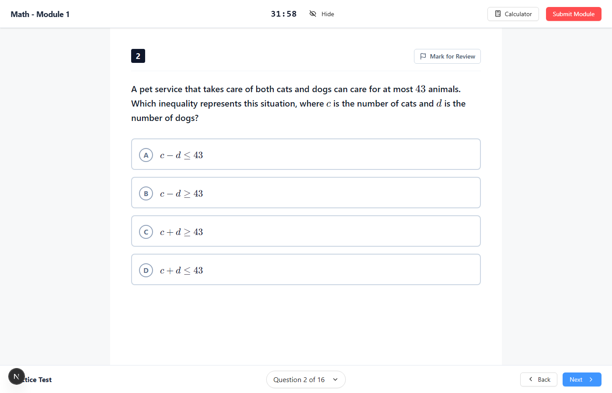

---

### 3. Math Question with Graph Figure & KaTeX Fractions
*Displays local figure `/demo-figures/...` rendered offline alongside function notation and vertical fractions.*
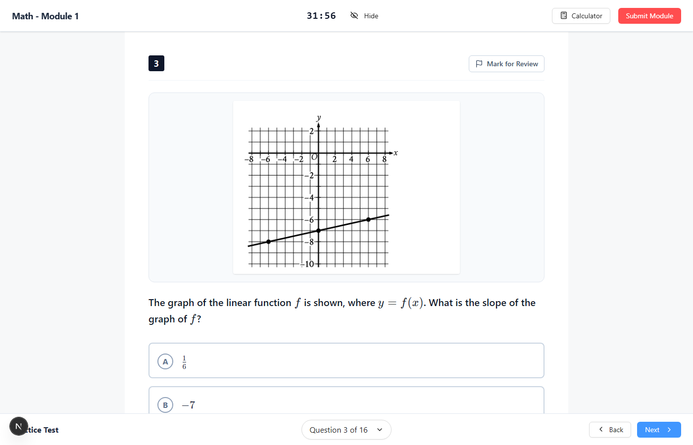

---

### 4. Reading & Writing Question with Table Figure
*Shows offline table figure and passage on the left panel, with logical completion choices on the right.*
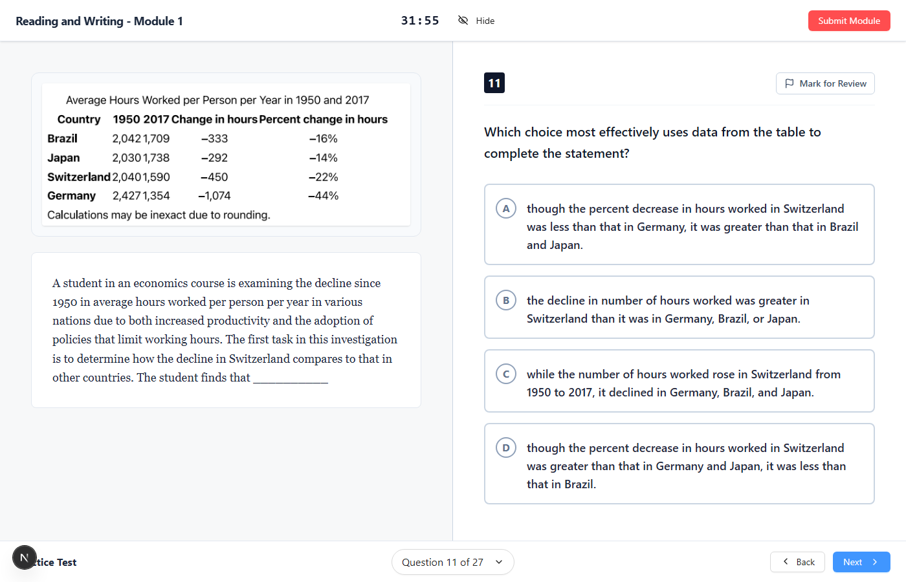

---

### 5. Review Mistakes Grid
*Full-length SAT review grid displaying color-coded answer bubbles (correct/incorrect) across all 4 modules with dynamic counts (27, 27, 15, 15).*
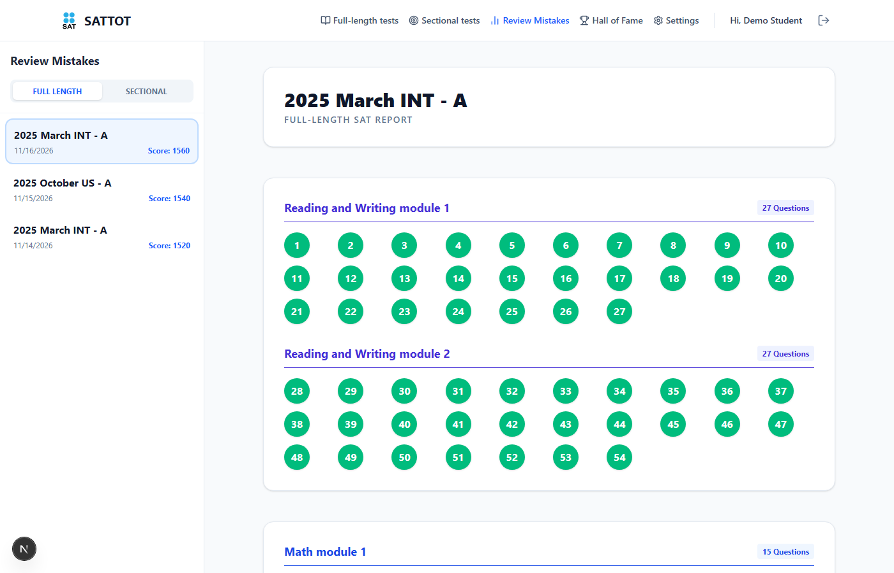

---

### 6. Review Question Modal with Explanation
*Displays question breakdown, chosen answer vs. correct answer, and detailed pedagogical explanation.*
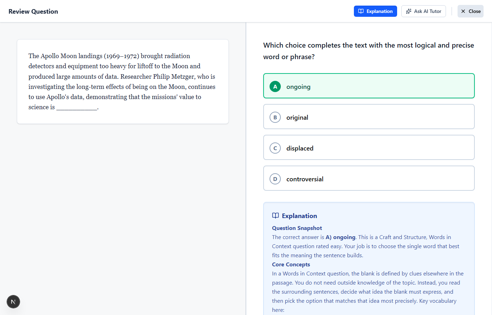

---

## 7. UML Architecture Diagrams

All UML diagrams are rendered from Mermaid source files located in `docs/uml/`. Both PNG and SVG formats are available.

### 1. Domain Model Class Diagram
Reflects domain entities, their attributes, types, and association multiplicities.
- **Source:** [`docs/uml/01-domain-class.mmd`](docs/uml/01-domain-class.mmd)
- **Vector:** [`docs/uml/01-domain-class.svg`](docs/uml/01-domain-class.svg)

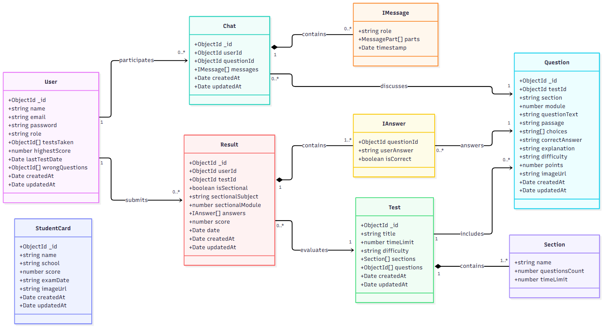

---

### 2. Layered Architecture Class Diagram
Illustrates the 4-tier architecture (API Route -> Controller -> Service -> Model & Zod Schemas) with strict dependency arrows.
- **Source:** [`docs/uml/02-layered-architecture-class.mmd`](docs/uml/02-layered-architecture-class.mmd)
- **Vector:** [`docs/uml/02-layered-architecture-class.svg`](docs/uml/02-layered-architecture-class.svg)

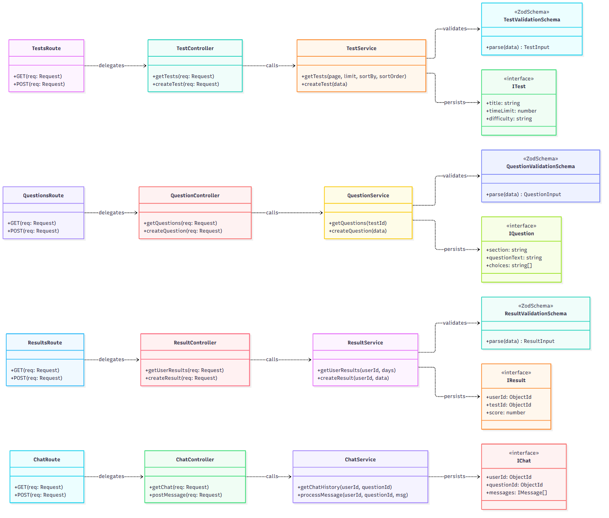

---

### 3. Use Case Diagram
Depicts primary actors (Student, Admin) and external systems (Gemini AI) interacting with system functional boundaries.
- **Source:** [`docs/uml/03-use-case.mmd`](docs/uml/03-use-case.mmd)
- **Vector:** [`docs/uml/03-use-case.svg`](docs/uml/03-use-case.svg)

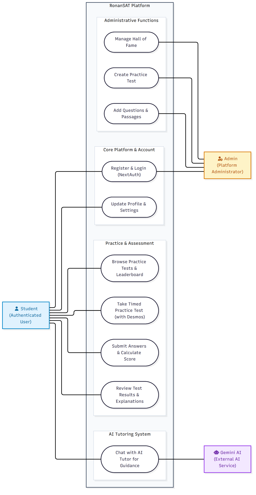

---

### 4. Sequence Diagram — Test Taking & Evaluation Flow
Step-by-step lifecycle from student test initialization, active question answering, submission, grading, database persistence, and score display.
- **Source:** [`docs/uml/04-sequence-take-test.mmd`](docs/uml/04-sequence-take-test.mmd)
- **Vector:** [`docs/uml/04-sequence-take-test.svg`](docs/uml/04-sequence-take-test.svg)

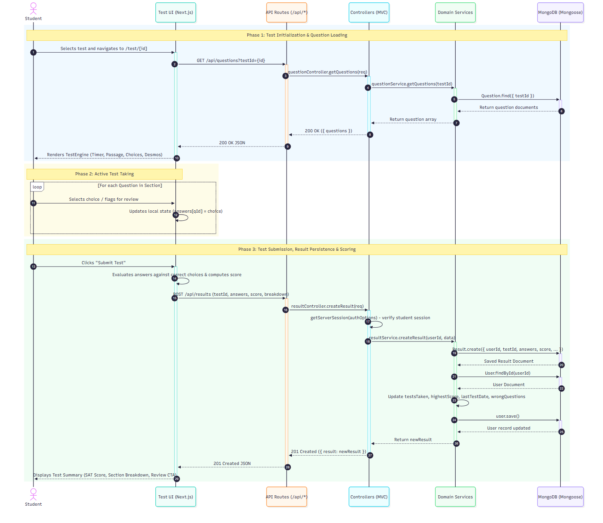

---

### 5. Sequence Diagram — Authentication & Session Flow
Registration, password hashing with bcrypt, NextAuth credential authorization, JWT token signing, and role verification.
- **Source:** [`docs/uml/05-sequence-login.mmd`](docs/uml/05-sequence-login.mmd)
- **Vector:** [`docs/uml/05-sequence-login.svg`](docs/uml/05-sequence-login.svg)

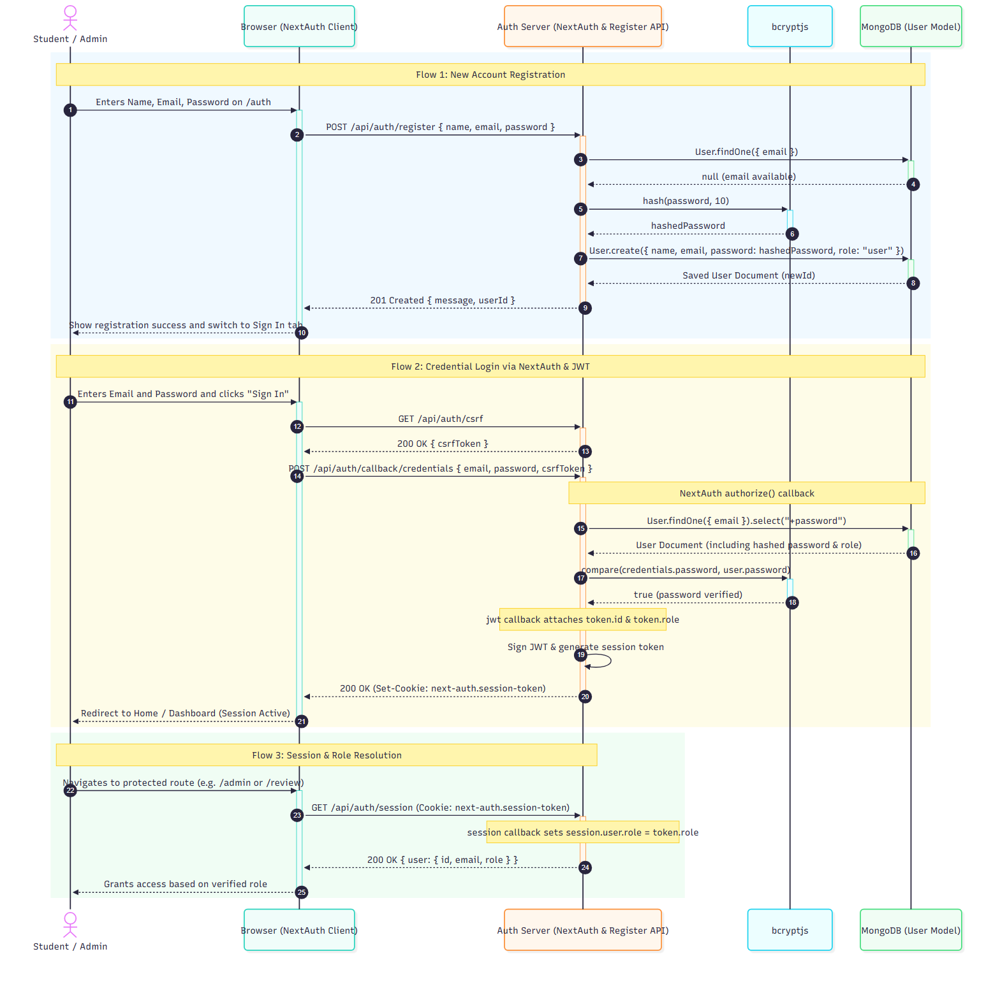

---

## 8. Verification & Quality Assurance

The codebase passes all automated verification standards:
- **TypeScript:** `npx tsc --noEmit` passes with **0 errors**.
- **ESLint:** `npm run lint` passes with **0 errors**.
- **Production Build:** `npm run build` succeeds with **0 errors**.
- **End-to-End HTTP Verification:** Automated tests pass across all routes, local image endpoints, and math rendering (`scripts/verify-endpoints.ts`).

---

## 9. Slides & Presentation

The OOP lab defense slide deck and presenter script are located in [`slides/`](slides/):
- **Slide Deck (PDF):** [`slides/main.pdf`](slides/main.pdf) — Complete 23-slide Beamer presentation (16:9 widescreen, full-slide UML diagrams with high readability, zero-wrap code listings, and architecture decomposition).
- **Presenter Script (Markdown):** [`slides/script.md`](slides/script.md) — 10–12 minute step-by-step speaker script with anticipated teacher Q&A defense answers.
- **LaTeX Source:** [`slides/main.tex`](slides/main.tex)
- **High-Resolution Page Previews:** [`slides/preview/`](slides/preview/) — Rendered 1920×1080 PNG images of all 23 slides for quick review.
- **Presenter:** Le Vinh — 202417221 | Group 08
